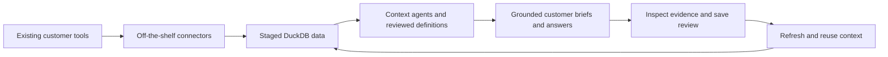

# Oriel

## Customer 360 for the tools you already use.

Prepare a customer review from the data in your existing tools. Connect supported sources, bring their output into DuckDB, and let a context agent propose the business definitions behind your customer briefs. Review those definitions, ask a question, and inspect the numbers and source passages behind the answer.

**[Try a customer review](docs/quickstart.md)** · [Connect your tools](docs/connectors.md) · [How the app works](docs/customer-360-app.md) · [Build goal and verification](docs/customer-360-goal.md)

Oriel is an open-source Customer 360 agent for technical customer-success and revenue-operations teams. CRM, conversations, support, product usage, billing and internal customer sources are peer inputs. The same customer workflow adapts to the evidence you have; no particular CRM or conversation platform is required.

**Developer preview for one local operator.** The latest tested revision passes 52 local and four configured-model acceptance cases across both synthetic customer stacks, including answers before and after refresh. Authenticated vendor compatibility and clean Git/public-checkout proof remain pending. [Evidence and limitations](docs/build-status.md).

## Start with the next customer review

> What is happening with this customer, what changed, and what evidence should I look at?

Open a customer brief with the available commercial, billing, support or conversation evidence. Inspect a calculation, follow a quoted passage to its source record, and save the review. Refresh the connected data to see what changed under the same reviewed definitions.

An invoice balance does not establish recurring revenue. An absent conversation source does not establish that a customer said nothing. Oriel retains these gaps alongside the answer.

## Try the local application

Use Python 3.10–3.14, [uv](https://docs.astral.sh/uv/) and a POSIX environment. Install from this repository; no separate package release is required.

These commands target the Customer 360 candidate. Current installation evidence uses an allowlisted copy of the local working tree and an isolated installed wheel. It does not yet prove that cloning the public repository reproduces this candidate; that publication and checkout check remains pending.

```sh
git clone https://github.com/anirudhagarwal-atlan/oriel.git
cd oriel
uv sync --frozen --extra connectors
uv run --no-sync oriel --workspace .oriel-customer customer app --port 8787
```

Open **http://127.0.0.1:8787**. Use a new private workspace. The app keeps source configuration, DuckDB data, reviewed context and job receipts there.

1. Choose **Billing + support** or **CRM + conversations**, then load the sample sources.
2. Prepare the review and approve explicit customer links and observed field mappings.
3. Materialize the reviewed customer data. Bootstrap context with your configured model, then review its proposed definitions before approval.
4. Open a customer, inspect its brief and evidence, ask a question, and save the review.
5. Load the refreshed sample, review any new source aliases, and compare the next brief using the same business definitions.

To explore without a model or source credentials, choose the clearly labeled **authored sample definitions** at step 3 and inspect the deterministic brief. Asking the model requires a separately configured Claude CLI, explicit data-access consent and a spending limit. Source records and context supplied to a model can leave your machine.

The samples execute the actual dlt SQLite extractor on synthetic source databases. They do not contact Salesforce, Gong, Stripe or Intercom. The billing/support sample works without CRM or transcript tables. [Complete walkthrough and troubleshooting](docs/quickstart.md).

## The required path



- **Connect once, analyze the captured data.** Context and answer tools read committed DuckDB snapshots. They do not fall back to querying source tools directly.
- **Review meaning before reuse.** Customer identity, field mappings, units, filters and gaps are explicit artifacts. A proposal is not an approval.
- **Keep answers inspectable.** DuckDB computes the numbers. Answers select validated metric results and exact attributed passages, with source, snapshot and context identities.
- **Preserve the next review.** Saved briefs retain historical evidence. New facts can change the answer without rewriting the definition; changed mappings or meaning require review.

The current context agent proposes definitions after explicit identity and mapping review. Generic direct-key source mappings are supported; complex relationship chains may need an adapter. Arbitrary prose, inferred health scores and autonomous customer actions are outside the initial answer contract.

## Bring your customer tools

The connector catalog spans APIs, SQL databases, object stores and files. Inspect the selected adapter's requirements and resources before configuring it:

```sh
.venv/bin/oriel source list --available
.venv/bin/oriel source describe salesforce
.venv/bin/oriel source doctor sqlite
```

The application accepts environment-variable names for credentials, never credential values. Configure and sync selected resources, capture a snapshot, map the observed fields to customer capabilities, and review the resulting context. Adding a source enriches the customer view; missing capabilities stay visible.

The catalog contains 101 source definitions, not 101 validated live integrations. Some adapters need extra drivers or SDKs. Gong-shaped sample data does not imply a packaged live Gong connector. [Connector readiness](docs/connectors.md) · [Application setup](docs/customer-360-app.md).

Existing file-based analytics, read-only MCP tools and local transformations remain available as advanced workflows. [CRM/product export recipe](docs/tool-exports.md) · [Agent setup](docs/agents.md).

## Evidence before claims

| Check | What it establishes |
| --- | --- |
| Real extraction on controlled sources | Off-the-shelf runtime → staged DuckDB, including failed extraction behavior |
| Two different customer stacks | Shared identity, context and answer contracts, including a stack without CRM or transcripts |
| Browser workflow with a labeled scripted model | Real interface interactions, separate approvals, evidence drill-down and refresh comparison |
| Configured-model browser smoke | Both profiles completed independently reviewed bootstrap and correct answers before and after refresh, reusing the same context: six jobs, twelve Claude Opus 5.5 calls, $1.4556692 in provider-reported list-price estimates, with no retries or unknown spend. This is a bounded synthetic workflow, not a general accuracy claim. See the dated [verification record](docs/customer-360-goal.md) |
| Isolated installation | The current working-tree package builds and runs outside its source directory. A clean committed Git checkout and public-clone reproduction still need their own proof |
| Live vendor checks | Still required for the integrations and resources we will advertise as verified |

Run the [acceptance runner](docs/customer-360-goal.md#how-verification-runs) to inspect your revision. Missing, skipped and unrun gates cannot produce an overall pass. Clean installation, actual model execution and authenticated vendor access are separate evidence requirements.

Comparative MCP/Rystic evaluations are deferred. No accuracy, cost or speed advantage is claimed. MCP remains an interface for compatible agent clients; the product's required data path stays the same.

## Help make the next customer review useful

Try both samples, then connect a source you are authorized to use. A useful issue describes the customer question, source types, setup step, expected behavior and a small synthetic reproduction. Keep private customer data and credentials out of public issues.

Contribute a source mapping, a reviewed definition, a connector verification or a reproducible onboarding failure. [Contributing](CONTRIBUTING.md) · [Product plan](docs/customer-360-plan.md).

MIT for Oriel. Bundled third-party code retains its own licenses and notices. See [LICENSE](LICENSE) and [attribution](docs/upstream.md).
