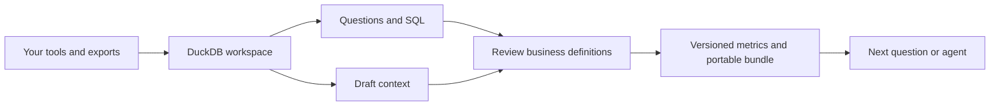

# Oriel

## Talk to data across the tools you already use.

Bring your tool data into DuckDB, ask questions with your agent, and keep the business definitions behind the answer for next time.

**[Get your first answer](docs/quickstart.md)** · [Connect a tool](docs/connectors.md) · [Use your agent](docs/agents.md) · [Explore the docs](docs/README.md)

Oriel is an open-source local analytics workspace for people building with agents. Combine CRM, product, billing, support or internal-tool data. Inspect the SQL, resolve what terms like “active” mean, and save reviewed context that another person or agent can reuse.

**Developer preview.** File workflows and local connector fixtures are verified. The catalog includes 101 source definitions; authenticated vendor connections remain unverified. [Readiness and evidence](docs/build-status.md).

## Start with a question that crosses tools

> Which customers are using fewer than half the seats they pay for?

Your CRM knows the contract. Your product tool knows the activity. Answering the question needs both, a customer mapping, and a definition of “using.” Oriel brings those pieces into one queryable workspace.

The included example finds **51 unused seats across five organizations**. After refreshing the activity data, the same definition returns **8 seats at one organization**. The definition survives the refresh and can be reused in a separate process. [Follow the complete example](docs/tool-exports.md).

These are reproducible results on synthetic data, not measured customer outcomes or model-performance claims.

## Try it locally

Install from this repository using the committed lockfile. It references public PyPI artifacts; a separate package release is not required for this walkthrough.

You need Python 3.10–3.14 and [uv](https://docs.astral.sh/uv/). Clone this repository and use a new `.oriel-quickstart` workspace. Commands below use a POSIX shell, including WSL on Windows.

```sh
git clone https://github.com/anirudhagarwal-atlan/oriel.git
cd oriel
uv sync --frozen

cb() { .venv/bin/oriel --workspace .oriel-quickstart "$@"; }
cb ingest examples/tool-exports/fixtures/crm-seats.csv --schema sales --table seats
cb ingest examples/tool-exports/fixtures/product-events-initial.jsonl --schema telemetry --table events
cb ingest examples/tool-exports/fixtures/workspace-map-reviewed.csv --schema directory --table workspace_map
cb context bootstrap
cb query "$(cat examples/tool-exports/sql/unused-seats.sql)"
```

The query's `rows` field contains:

```json
[{"unused_seats_at_low_activation": 51}]
```

No API key, model, source account or simulator is needed. After dependency installation, these commands run locally. The example supplies its own reviewed identity mapping and SQL; bootstrap produces a **draft**, not an inferred or approved business definition.

**Next:** the [quickstart](docs/quickstart.md) walks through reviewing the metric, refreshing the data and exporting its context. Prefer to inspect the account-level calculation first? Open the [recipe and expected rows](docs/tool-exports.md#inspect-the-answer-and-retain-a-local-result).

## Bring your own tools

Use an export to start, or configure a connector for repeat extraction into the same workspace.

| Your starting point | Path |
| --- | --- |
| CSV, JSON, JSONL or Parquet exports | `ingest` imports a local file into a named table. [Walkthrough](docs/tool-exports.md) |
| An API, SQL database or object store | Inspect `source describe` and `source doctor`, configure credentials by environment-variable reference, then sync. [Connector guide](docs/connectors.md) |
| A compatible existing DuckDB snapshot | Import explicitly selected tables. [Snapshot compatibility](docs/upstream.md) |

```sh
uv sync --frozen --extra connectors
.venv/bin/oriel source list --available
.venv/bin/oriel source describe salesforce
.venv/bin/oriel source describe mixpanel
.venv/bin/oriel source doctor sqlite
```

Catalog inspection makes no source calls. A tool's required packages, credentials, resource selection and limitations are visible before extraction. Some sources need additional drivers or SDKs. The connector runtime uses dlt; no dependencies are installed automatically during sync.

The product works across source types. “Your existing tools” means supported exports and adapters, with readiness checked per connector. It does not promise one-click authentication for every service.

## Turn one answer into reusable context



- **Bring the data together.** Query and join tables across sources; keep import and snapshot evidence.
- **Make the meaning explicit.** Bootstrap schemas, candidate keys and joins. Review identity mappings, populations, exclusions and time windows.
- **Keep the definition.** Propose metric SQL, inspect its execution evidence, approve the exact version, and rerun it on refreshed data.
- **Carry it forward.** Export definitions, schemas, an agent skill and hashes. A separate consumer can use the bundle with its own compatible data.

You can inspect these artifacts locally without a registry account. Registry publication and team access controls belong to the receiving system; bundle export performs no upload. [How context becomes reusable](docs/context-guide.md).

## Ask with your agent

For the built-in question loop, install and authenticate the Claude CLI separately. After the example imports above:

```sh
.venv/bin/oriel --workspace .oriel-quickstart ask --allow-model-data \
  "Inspect the available data and context. Which identity and business rules need review before calculating product activation?"
```

This is a model call: the question, context and relevant tool results can reach your configured provider. SQL queries and bootstrap do not require a model. The agent's answer may vary; the deterministic query above is the checked result.

Oriel also exposes read-only tools over **MCP stdio** for a compatible agent client. [Agent setup and data boundaries](docs/agents.md). Local transformations and exact-preview row changes are separate CLI workflows; they do not update your source applications.

## What you can rely on today

| Capability | Current evidence |
| --- | --- |
| Import → query → review → reuse → refresh | Reproducible synthetic CRM/product walkthrough, including a separate consumer |
| Connector extraction | Real dlt execution with SQLite and selected local REST/GraphQL fixtures; failed extraction retains the prior snapshot |
| Packaging | Clean-install verification of the wheel, bundled definitions and licenses |
| Vendor connectivity | Not yet authenticated and validated against live vendor accounts |
| Agent performance | Comparative accuracy, cost and latency evaluations are deferred |

MCP is an interface Oriel supports. We make no claim that this repository is “better than MCP.” [Detailed status](docs/build-status.md) · [FAQ](docs/faq.md) · [Roadmap](docs/roadmap.md)

## Help shape the next workflow

Try the example, bring one approved export, and tell us where you got stuck. A useful issue includes the question you wanted to answer, source types, expected behavior and a small synthetic reproduction. Keep credentials and private data out of public issues.

Contribute a recipe, improve a connector's tested coverage, or make a business definition easier to review. [Contributing](CONTRIBUTING.md) explains how to start. [Use cases](docs/use-cases.md) shows runnable examples and questions to adapt.

MIT for Oriel. Bundled third-party code retains its own licenses and notices. See [LICENSE](LICENSE) and [attribution](docs/upstream.md).
