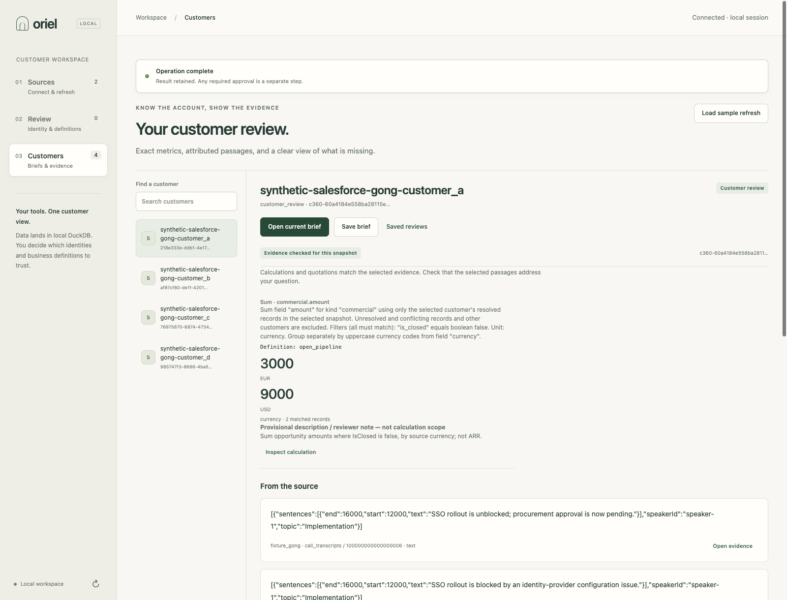
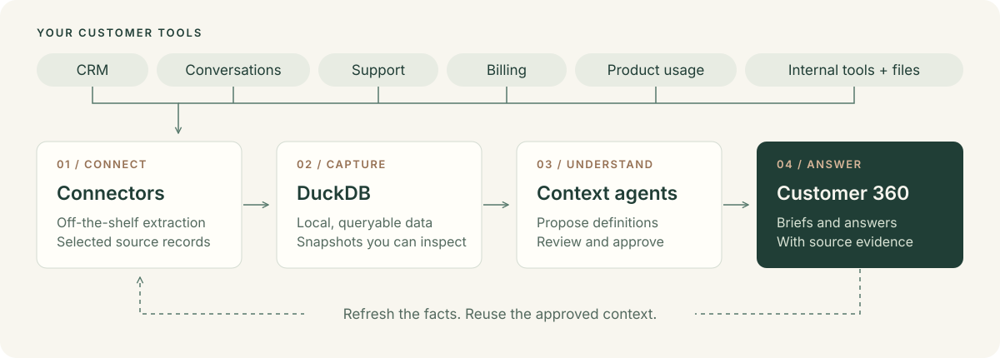

# The open-source Customer 360 agent

Get the customer story from the tools you already use. Oriel brings customer data into **DuckDB**, helps you define what it means, and builds customer briefs and answers with evidence you can inspect.

**[Get started](#quickstart)** · [Documentation](docs/README.md) · [Connect your tools](docs/connectors.md) · [Contribute](CONTRIBUTING.md)

Built for customer success, account teams, and the technical teams supporting them. Bring CRM, conversations, support, billing, product usage, or internal data. Start with the sources you have.

> **Developer preview.** Run locally for one operator. Try both sample workflows without vendor credentials or model calls. [What works today →](docs/build-status.md)

## Quickstart

You'll need Python 3.10–3.14, [uv](https://docs.astral.sh/uv/), and macOS or Linux.

```sh
git clone https://github.com/anirudhagarwal-atlan/oriel.git
cd oriel
uv sync --frozen --extra connectors
uv run --no-sync oriel --workspace .oriel-customer customer app --port 8787
```

Open **http://127.0.0.1:8787**, then:

1. **Connect a sample.** Choose **Billing + support** or **CRM + conversations**.
2. **Review the context.** Follow the identity and field-mapping reviews, then use the authored sample definitions. No model needed for this route.
3. **Open a customer brief.** Inspect a calculation or source passage, save the review, and load the sample refresh to see what changed.

[Follow the walkthrough](docs/quickstart.md) for the exact review steps. To bootstrap definitions with a context agent and ask questions, use a separately installed, authenticated [`claude` CLI on your `PATH`](docs/agents.md#ask-through-an-authenticated-claude-cli), enable model access, and set a spending limit. Selected data is sent to the model only with your consent.

## Walk into the next customer conversation prepared



*The working application with synthetic sample data. [Reproduce this workflow](docs/quickstart.md).*

- **Put the account in context.** Bring commercial records, billing, support, and conversations into a customer view, with explicit links between source records.
- **Follow the answer to its evidence.** Inspect the metric definition, the DuckDB calculation, and the attributed source passage. Missing information stays visible.
- **See what changed.** Save a brief, refresh the source data, and compare the next review using the same approved definitions.

Start with a concrete question: “What is outstanding on this account?” or “What does the latest support update say?” The available sources and reviewed definitions determine what Oriel can answer.

## From your tools to an answer you can inspect



1. **Connect.** Use off-the-shelf connectors to extract selected resources from your tools.
2. **Load into DuckDB.** Keep queryable snapshots in your own local workspace.
3. **Bootstrap context.** Review customer links and field mappings. A context agent proposes business definitions; you inspect and approve them.
4. **Ask and inspect.** Compute answers against the captured data, follow the evidence, and reuse the context after refresh.

Definitions include the details that change an answer: what “open” means, which records belong to a customer, and whether an amount is in dollars or cents. The agent works from this reviewed context and the DuckDB snapshot.

## Bring your customer stack

Oriel's connector catalog covers customer APIs, SQL databases, object stores, and files. Explore an adapter before configuring it:

```sh
uv run --no-sync oriel source list --available
uv run --no-sync oriel source describe salesforce
```

The customer workflow is independent of any one vendor. The included examples pair billing with support and CRM with conversations; neither pair is required. Add sources and map their fields to the customer information you need.

**A catalog entry is not a verified live integration.** Adapter requirements and resource coverage vary. Both included samples use real SQLite/dlt extraction on synthetic data; they do not connect to vendor accounts. See [connector readiness](docs/connectors.md#what-has-been-verified) and [the own-data setup guide](docs/customer-360-app.md).

## Build with us

Try a customer review and [tell us where you got stuck](https://github.com/anirudhagarwal-atlan/oriel/issues). Useful contributions include source mappings, reviewed definitions, connector validation, and clearer onboarding.

[Contributing](CONTRIBUTING.md) · [Roadmap](docs/roadmap.md) · [Architecture](docs/architecture.md) · [CLI and MCP](docs/agents.md) · [FAQ](docs/faq.md)

Oriel is MIT licensed. Bundled third-party components retain their licenses and notices. [License](LICENSE) · [Attribution](docs/upstream.md)
