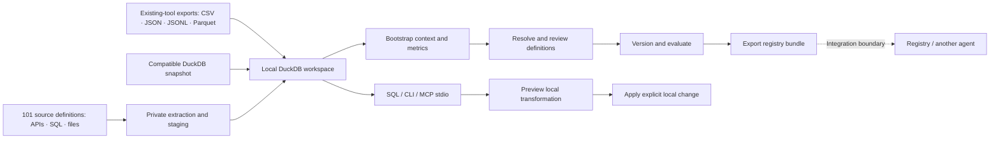

# Architecture

DuckDB `DECIMAL` query values are returned as exact strings with a `decimal_columns` type map. This preserves amounts beyond floating-point precision in results, execution hashes, and approval checks.

Oriel lets users talk to data across their existing tools: import operational exports or source snapshots, query and transform them in DuckDB, make business definitions explicit, and export reusable context with evaluation evidence. The analysis and context lifecycle are independent of source brands. Rystic's Stripe + Linear pair supplies the first synthetic benchmark environment.

The diagram shows the workflow, including human review. Exporting a bundle does not imply it has passed every review or evaluation step; inspect the artifacts and their recorded state before sharing.

## Data plane

The workspace holds local imported data in DuckDB. Sources include files the operator supplies, an explicit compatible DuckDB snapshot, the connector layer and the separate Rystic simulator adapters. The connector catalog contains 101 definitions; actual dlt extraction is verified on synthetic SQLite and selected loopback REST/GraphQL resources; authenticated vendor extraction remains unverified. Import is a point-in-time operation. A successful import does not establish that a source is fresh, complete, or authorized for every later consumer.

The Rystic adapter records required refresh attempts before source reads. A failed or interrupted attempt preserves historical tables and blocks the ordinary query/catalog/metric/transform/change boundary. Complete validation and successful materialization commit together before reads resume. CLI `refresh-status` and both MCP paths expose the recorded state without contacting a source; direct-source tools remain available. Generic file imports do not gain automatic freshness monitoring from this adapter-specific lifecycle.

Any tool that can provide a supported export can enter the generic workflow. The connector layer adds packaged API, database and filesystem adapters with explicit credential injection; it has no managed OAuth authorization flow. Adapters supply observed tables, source identity and snapshot evidence to the same workspace interface without changing analysis, metric approval or bundle formats. The Rystic recipe's payment/issue policy stays separate from generic business-definition bootstrap.

SQL performs joins, filters, and aggregations. The important architectural choice is where those operations run and how much data reaches the model. A row-oriented tool can make the model retrieve and combine many records; a SQL tool can return a small computed result. Source-side aggregation can have the same benefit when a source supports it well.

CLI queries and MCP stdio tools expose the same local workflow. MCP is the transport and tool contract, not an alternative database. A local SQL tool served over MCP is still a local SQL data path.

## Context plane

Data types do not explain business meaning. Oriel bootstraps candidate definitions from the imported schema and example data. Candidates are starting points for review, not discovered truth.

The intended lifecycle is:

1. **Candidate:** name the definition, scope, and unresolved assumptions.
2. **Evidence:** associate it with source fields, examples, and provenance.
3. **Resolve:** make decisions about ambiguous terms, joins, time periods, and exclusions.
4. **Approve:** record an explicit review decision before treating the definition as authoritative.
5. **Version:** preserve the approved definition as an inspectable artifact.
6. **Evaluate:** run expected-answer cases, retain failures, and export the supporting evidence.

The older generic synthetic demo makes three semantic choices visible: ARR uses recurring annual value rather than total contract value; qualified pipeline excludes S1; the demonstrated fiscal quarter spans August through October. The Rystic fixture separately declares payment, refund and unresolved-issue rules. These are fixture-specific definitions, not universal business rules.

## Agent plane

The model-backed `ask` workflow uses an already configured Claude CLI. The deterministic demo, SQL query, and metric workflows do not need a model key. Model-generated SQL and answers need the same inspection as other generated code; an answer is only as trustworthy as its data, definitions, and evidence.

`ask` and model benchmarks send their prompts, context, and relevant tool results to the configured model provider. Imported workspaces require `ask --allow-model-data`; the legacy model benchmark accepts only the unchanged generic synthetic demo. The Rystic development pilot requires a reviewed frozen plan and explicit model-data consent. Its held-out release study remains pending. A local database does not make model inference local.

`oriel serve` exposes the local tool interface over MCP stdio for a compatible client. It is not an HTTP server or a hosted database. Keep diagnostics off stdout so the protocol stream remains valid.

The [example agent skill](../examples/talk-to-data/SKILL.md) describes how to inspect available data, use approved definitions, report ambiguity, and distinguish a proposed change from an applied one.

## Local changes

Transformations operate on the local workspace. A local table change is not a change in a CRM, billing service, ticketing application, or other upstream tool. The MVP does not provide live source-system writeback.

Before applying a local change, inspect its scope and the exact preview. Keep a reproducible transformation and enough provenance to explain the result. An agent should report the target, affected data, and resulting artifact explicitly, and should never describe a local simulation as a completed upstream action.

`transform` materializes a restricted SELECT into a new `models.*` table. `changes plan` previews an update to exactly one local row; `changes apply` requires the preview's exact SHA-256 and rejects a stale row. These mutation commands are CLI operations. The MCP tools and model-backed question loop are read-only.

SQL filtering and tool policy reduce accidental misuse but are not a substitute for an operating-system sandbox. The process has the operator's local permissions. Do not expose an untrusted workspace, source file, or MCP client to a more privileged runtime.

## Registry boundary

A bundle carries reusable context, metric definitions, an agent skill, and available evaluation material. Treat it as an inspectable handoff, not an automatic production deployment. Registry publication, identity, access controls, approval policy, distribution, and recurring evaluations belong to the receiving registry's workflow.

The critical handoff is semantic: the next agent should receive both the definition and enough evidence to know when it applies. “ARR means this SQL everywhere” is less useful than a versioned definition with its sources, scope, examples, and tests.

## Benchmarks

Replay benchmarks execute predefined plans on synthetic fixtures. They measure the implementation's data-path behavior without testing a model's planning. Model benchmarks invoke a configured model and capture actual completion behavior and provider usage where available. Reports must label the mode, model, task, dataset, context condition, failures, and measurement boundaries.

Separate initial ingestion from warm queries. Compare equivalent data and semantics. A source-side aggregate or an optimized MCP server can eliminate advantages seen against a paginated row-fetch baseline. Do not turn a small smoke run into a universal claim about models, tools, or MCP.

The Rystic pilot launches this package's real stdio MCP server separately for each trial. Both arms get the same temporary result calculator: restricted DuckDB SQL over only the tool responses that trial has retrieved. The scratch database has no source snapshot or external access. Independent manifest-based scoring checks exact integer-cent values, complete account/issue sets and owners. Frozen code/context/data hashes and pre/post source checks make the tested state inspectable; the public pilot tasks cannot satisfy the held-out release gate.

The warm and observed-phase pilots share that agent loop. Phase planning binds an exact retained source capture to the recorded workspace refresh attempt, including refused refreshes that block historical SQL reads. Execution checks source stability before and after the trials. The template compiler freezes semantic task commitments without inventing future observations. A separate source-transition executor requires exact plan/action approvals, checks before/after state and checkpoints partial or uncertain writes; it is absent from agent-facing tools and does not refresh a workspace. Development packets remain ineligible for acceptance.

The distinct acceptance preparation path validates allocated baseline intent, freezes reviewed model/power/accounting conditions and binds full source evidence and fresh-workspace snapshot chains. Those preparation and validation commands make no source/model calls and grant no execution authorization. Offline receipt collection and reporting enforce the frozen order, rescore paid answers and reconcile separate event accounting without moving earlier work into later phases. A private digest-addressed store deduplicates binding history.

The [study controller](../contextbase/study_controller.py) now implements cumulative cost, call and elapsed-budget enforcement across phases. Its runtime adapter uses frozen assignments to separate local simulator pairs, installs the exact approved context in a fresh workspace before its first import, and preserves that artifact across refreshes. It binds each original sync capture, including refused refreshes, and checks the full source projection and local context before and after the shared agent loop. A phase transition follows completion of both arms and postflight. Failed or uncertain operations retain partial evidence and stop the study; automatic resume is disabled. Controller tests exercise this sequence with in-memory sources, actual local DuckDB and scripted responses. They do not establish native execution or comparative agent performance. Native isolation, lifecycle, provisioning and authorization integration still need verification, followed by actual power/accounting/rate reviews and the approved study.

The controller's runtime interval starts after offline protocol/input validation and runtime construction, and ends before final statistical reporting and export. These excluded analysis costs and durations are unmeasured, not zero. Retained workload charges and provisioning apparatus do not yet constitute complete billing reconciliation; an all-in cost claim requires that additional accounting.

## Current limits

- Local file imports, a snapshot bridge, Rystic simulator adapters and a 101-entry connector catalog are available. The new source CLI publishes a staging database atomically and bootstraps context; its file path is verified. The optional runtime is pinned in the lockfile; native SQLite and selected loopback REST/GraphQL extraction are verified. Vendor authentication and other source-specific integrations remain unverified. There is no managed sync service or OAuth browser flow.
- Snapshot freshness and source permission enforcement remain operator responsibilities.
- Fixture-scale evaluation does not establish large-data performance.
- Bootstrap candidates need review; inferred business meaning can be wrong.
- Local transformations do not update upstream applications.
- Bundle export does not deploy to a hosted registry.

## Connector lifecycle

`source add` stores only credential environment-variable names and allowlisted noncredential parameters. `--replace-config` preserves the previous configuration and uses the same lock as sync; sync reads configuration after acquiring that lock. `source sync` starts a private worker with pinned source definitions and explicit credentials, isolated dlt configuration, disabled telemetry and no automatic dependency installation. The worker loads a separate DuckDB snapshot. The parent validates table ownership and atomically copies all staged tables and a publication receipt into the workspace. An incomplete extraction or missing previously loaded table refuses publication. `source list` separates the latest attempt from the last committed snapshot. Sync retains previous data on failure; it does not label it current source state. The parent removes allowlisted worker scratch directories after completion or timeout, retaining the staged database and sanitized receipts.

After publication, schema profiling generates a context draft. Business rules remain proposals until reviewed. Every sync uses fresh extraction state; connector defaults may still scope data by date or resource. A snapshot is not a claim of complete source history or transactionally consistent reads across independent services. Source-specific SDK credential behavior and compatibility need integration checks before a connector is described as live-validated. See the [connector guide](connectors.md).

See [integration notes](upstream.md) for snapshot compatibility and [evidence policy](gtm.md#scorecard-and-evidence-policy) for the requirements before making public claims.
