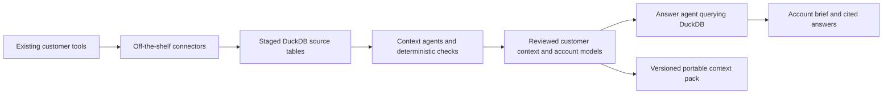

# Oriel: Customer 360 agent build plan

Status: implementation plan under the [active Customer 360 build goal](customer-360-goal.md), 9 October 2026. This is the next product direction, not a description of shipped capabilities. It supersedes generic “talk to any tool” as the next launch positioning. Existing source adapters and local analytics remain the foundation. Comparative evaluations remain deferred.

Implementation note: [Customer 360 foundation commands](customer-360-foundation.md) expose stable identity, verified snapshots and reviewed source mappings locally. The [customer CLI](customer-360-cli.md) adds context bootstrap/review, exact metrics and quotations, model questions and retained brief comparisons. The [local application](customer-360-app.md) now exposes the shared workflow; both sample stacks have actual browser verification with a labeled scripted transport. The fuller product vision below still includes later work. Local functional checks and real-model/live-source evidence are tracked separately by the [acceptance contract](../verification/customer360/acceptance.json).

## 1. Product decision

**Oriel is an open-source Customer 360 agent for the customer tools you already use. It connects customer data across systems, builds reusable business context, and answers customer questions with evidence.**

Proposed headline: **Know the account. Understand what changed.**

Supporting copy: Bring together your CRM, support, product usage, billing and customer conversations. Oriel connects your existing tools to DuckDB, builds customer context, and explains what is happening with each customer and what changed.

Customer 360 defines the product's job. The tools supplying the data are interchangeable integrations. No particular CRM, conversation platform or fixed pair of sources is required. Supported connector capabilities and verified coverage remain explicit; this direction does not claim every vendor already has a working integration.

The initial user is a CSM or account owner preparing a customer conversation or renewal review. A RevOps or technical operator sets up the workspace. This audience is the working recommendation pending feedback; sales preparation and portfolio analytics can use the same account model later.

The first useful job is: **“Prepare my customer review: what is happening with this customer, what changed, and what needs follow-up?”** The brief uses the evidence available in that workspace: commercial status, adoption, support, conversations or billing. Renewal prioritization follows when the workspace has reviewed renewal dates and commercial definitions. An opportunity or invoice amount alone does not establish ARR or a renewal obligation.

Source categories belong in the product model from the start, even when their individual integrations ship at different times. A CRM-plus-conversation workspace and a billing-plus-support-plus-usage workspace use the same customer model and answer interface. A single connected source can give a partial view; adding sources enriches it. Show what is covered and what is unknown rather than forcing a prescribed stack.

## 2. What the finished experience looks like

The user opens a product organized around accounts, with a useful brief before they need to invent a prompt.

| Surface | User experience |
| --- | --- |
| Connect | Choose the customer tools already in use, authorize each supported credential flow, select resources and history, and see sync progress and missing permissions. |
| Setup review | Review proposed account links, field mappings and a short list of business definitions. Resolve only ambiguities that affect the chosen workflow. |
| My accounts | Search or filter a portfolio by available attributes such as owner, adoption, support status or renewal window. Show source coverage and freshness. |
| Account workspace | Customer identity and relationships, available commercial/usage/support/conversation facts, open questions, changes since the last review, and the supporting timeline. |
| Ask Oriel | Ask within one account or across a selected portfolio. Inspect numerical calculations, relevant record or text excerpts, source links and limitations. |
| Context | See definitions and mappings, who reviewed them, their versions, and which briefs need rebuilding after a change. |
| Saved reviews | Reopen a brief, add a correction, refresh the sources, and see what changed using the same definitions. |

Example questions:

- “Brief me on example-account before its renewal review.”
- “Which accounts renewing in the next 90 days have an unresolved commitment mentioned on a recent call?”
- “What has changed since the last account review?”
- “What evidence supports expansion interest, and which stakeholders expressed it?”
- “Which paying customers have declining usage and unresolved support issues?”
- “Which onboarding accounts need attention, and what evidence explains why?”

Every answer separates observed facts, agent interpretation and suggested next steps. It reports its as-of date, data window and gaps. A source link is accompanied by the exact record or text segment that supports the claim. No matching records in an incomplete extraction does not mean no activity. Available sources determine which questions can be answered; the interface explains missing evidence instead of requiring Gong, Salesforce or another specific vendor.

The product inspiration is Databuddy's focused analytics experience: a clear user job, an integrated analyst and inspectable queries. Its investigation experience also makes evidence and follow-up visible. Applying those ideas to account reviews is our proposed product design. [Databuddy repository](https://github.com/databuddy-analytics/Databuddy), [Databunny experience](https://www.databuddy.cc/databunny).

## 3. Non-negotiable execution path

1. Existing connector implementations own source extraction, pagination and source authentication. Oriel adapts their output and manages publication into its workspace.
2. Selected records, events and text land in DuckDB before context or answer generation. File import remains a development and recovery path; an export-only demonstration does not complete the connector milestone.
3. Context agents inspect the synchronized data and propose customer mappings, business definitions and structured evidence from the available source categories. Deterministic code validates their proposals.
4. Reviewed definitions and explicit identity relationships produce customer models. Unknown mappings and unapproved meanings are retained as unresolved, not silently guessed.
5. The answer agent uses those models and context against a pinned local snapshot. Source credentials are unavailable to it. A refresh must finish before an answer can use newly requested source data.
6. Answer receipts identify the source snapshot, context version, executed queries, evidence and coverage. A later session can reproduce the calculation and identify which source facts changed.

MCP can expose this completed workflow to another agent. It does not replace the connector → DuckDB → context → answer path. No direct source-MCP fallback is part of the product answer path.

## 4. Connector plan

**Choose integrations by customer workflow and available source access, not a mandatory vendor pair.** Each adapter declares the customer entities, facts, events, text and freshness information it supplies. The account and context interfaces depend on those capabilities, not vendor names.

| Source category | Illustrative tools or inputs | Customer context supplied |
| --- | --- | --- |
| CRM and customer directory | Salesforce, HubSpot, Attio, an internal customer database | Accounts, people, owners, opportunities and customer relationships |
| Conversations and communication | Gong, meeting transcripts, email, customer communication channels | Needs, commitments, objections, stakeholders and dated statements |
| Support and success | Zendesk, Intercom, customer success systems | Cases, issues, response history and customer follow-up |
| Product usage | Mixpanel, Amplitude, application events | Adoption, activity, seats, onboarding and feature usage |
| Billing and subscriptions | Stripe, Chargebee, finance systems | Payments, subscriptions, recurring value and commercial status |
| Internal sources | SQL databases, object stores and supported files | Customer identifiers, entitlements and organization-specific facts |

These are examples of the intended source categories, not a list of verified live integrations. Onboarding should display readiness per connector and required data per question. The initial release needs representative coverage and a portability proof, not simultaneous implementation of every named source.

**Salesforce + Gong remains one proposed reference implementation.** It exercises structured CRM data plus customer conversation evidence. The research below is specific to that example; neither integration is a dependency of the shared Customer 360 model.

| Source | Minimum data | Implementation decision |
| --- | --- | --- |
| Salesforce | Accounts, contacts, owners/users, opportunities; customer-specific renewal/recurring-value fields or contract objects when available | Start from the existing bundled dlt Salesforce source. Verify required resource and custom-field discovery, supported authentication, extraction coverage and optional dependencies. |
| Gong | Calls, participants, CRM object references, transcripts with speakers and timestamps | Adopt an existing extractor and a thin output bridge into the same staged DuckDB publication path. Verify transcripts and CRM references before selecting it. |
| Alternative or additional sources | Support cases, customer usage, billing/subscriptions, other CRM records | Reuse existing connectors and map their outputs to the same customer capabilities. Choose the next source from available access and an unanswered customer question. |

Gong is absent from Oriel's current catalog. An off-the-shelf candidate is Meltano's Singer `tap-gong`; Airbyte also publishes a Gong connector. Their presence in catalogs is evidence of available implementations, not proof of Oriel compatibility. [Singer candidate](https://hub.meltano.com/extractors/tap-gong--symon-ai/), [Airbyte connector](https://docs.airbyte.com/integrations/sources/gong), [dlt sources](https://dlthub.com/docs/dlt-ecosystem/verified-sources).

For each selected source, first prove the resources required by its customer workflow in a bounded connector spike. Prefer a candidate that supplies those resources, supports a usable authorized-account flow, preserves state correctly and requires the least additional runtime. For the Gong example, those requirements include transcripts and CRM references. Pin and review the chosen upstream dependency. Do not implement competing connector engines speculatively or build a new vendor API client as the default route.

For the Salesforce/Gong example, the first feasibility path is the existing dlt Salesforce source plus an isolated Airbyte Gong runner. Airbyte's Gong manifest exposes calls, extensive calls, transcripts and users, including Salesforce Account/Opportunity references and CRM context timing. Its connector metadata declares ELv2; confirm the distribution and deployment fit before adoption, and keep its licensing separate. The Singer alternative has relevant streams but currently requires Python 3.13 and needs closer checks on state, field normalization and visibility. Decide after the spike rather than promising an unverified installation path. [Airbyte Gong source](https://github.com/airbytehq/airbyte/tree/master/airbyte-integrations/connectors/source-gong), [Singer implementation](https://github.com/symon-ai/tap-gong).

For Salesforce, the present Oriel adapter exposes username/password/security-token authentication; a catalog OAuth label is not a working OAuth setup flow. The source can discover accessible custom fields on its supported objects, but contracts and arbitrary custom objects need additional coverage. Sandbox configuration and the optional Salesforce SDK also need explicit setup and verification. [Salesforce source documentation](https://dlthub.com/docs/dlt-ecosystem/verified-sources/salesforce).

Each published source receipt must record selected resources and fields, extraction bounds, completed pages, timestamps, row counts, connector version, known exclusions and failures. Failed or partial loads must not become a current account snapshot. The existing runner uses fresh extraction state each sync: persistent incremental state and deletion handling require implementation and verification before we promise efficient recurring sync.

Adding a source should require connector configuration, a mapping into customer entities/evidence and source-specific checks. It must not require rewriting the account UI or answer agent. Connector capability metadata should identify supported entities, source keys, event times, provenance, visibility and coverage; available questions follow those capabilities.

## 5. Customer data model

Use three logical layers in DuckDB:

- `raw_*`: selected source records with stable source IDs, extraction IDs and observation timestamps.
- `customer_*`: normalized customers/accounts, people, source identity links, dated facts and events, with optional commercial, support, usage and conversation models according to connected data.
- `context_*`: proposed and reviewed mappings, definition references, structured evidence, source coverage and answer evidence. Versioned portable definitions can also be exported as JSON artifacts.

An Oriel workspace customer ID anchors identity independently of vendors. A mapping table relates it to `(connection, source entity, source record ID)` and records the evidence, review state and effective dates for each relationship. A workspace can nominate a CRM, billing system or internal customer directory as its authoritative identity source; none is required universally. Prefer explicit cross-system IDs and reviewed mappings. Domains and names can propose links but must not silently merge customers. Preserve account hierarchies, person-to-account relationships, multi-account events and unresolved links.

In the Salesforce/Gong example, resolve Gong Account references directly through the identity map and Opportunity references through Salesforce's Opportunity-to-Account relationship. This is an adapter mapping, not the canonical customer key. Preserve all source IDs as strings and distinguish current relationships from those at event time; reassignment must not rewrite historical evidence without explanation.

Keep structured facts separate from interpretation. Every fact or claim needs a source record or text segment, an event/observation time, a customer-link basis and an extraction version. Conversation evidence additionally preserves speaker and segment timestamps when available. “Customer mentioned a budget review” is evidence; “this customer will churn” is an inference and may not be justified. The same distinction applies to support comments and other customer text.

Build account-level aggregates before joining one-to-many conversations or contacts, so commercial value is not multiplied. Keep currencies and financial units explicit. Maintain observation history for “what changed”; a current-only source snapshot cannot establish a historical change that was never captured.

## 6. What context agents actually do

Use bounded stages behind one orchestrator, with explicit inputs and persisted outputs. Separate every agent proposal from the deterministic checks and review required to use it.

| Stage | Output | Required checks |
| --- | --- | --- |
| Source and schema context | Resource descriptions, candidate fields, source coverage and gaps | Real columns, types, extraction windows and nonempty/empty distinctions |
| Account identity context | Proposed source-to-account links and unresolved matches | Uniqueness, collision checks, cardinality and reviewed ambiguous relationships |
| Business context | Definitions supported by the workspace: customer, owner, active user, renewal, recurring value, unresolved issue, open commitment and relevant periods | Field lineage, units, population, time rules, sample calculations and explicit review |
| Customer evidence context | Dated usage/support/commercial observations and claims from available customer text | Records or text segments cited; attribution retained; contradictions, missing coverage and expired claims visible |
| Account synthesis | A structured brief and a list of missing evidence | Each factual assertion traceable; inference labeled; snapshot and context versions pinned |

The context bootstrap must do more than summarize schemas. It should determine which customer questions the connected sources support, then resolve relevant definitions: for example, what counts as active usage, which issues remain open, whether an amount is recurring, or whether an event belongs to an account. It should first inspect available metadata and existing definitions, then request the smallest decision that cannot be resolved from evidence. Conversation extraction runs when conversation data exists; the product must also work with no transcripts or CRM.

Cache work by source content hash and context version. Reprocess changed evidence and affected customers after refresh; avoid rereading all text for every question. Apply bounded model-call and context budgets. SQL computes numbers; the model interprets results and cited customer evidence.

Review business rules and ambiguous identity once, then reuse them. Routine source refreshes do not require repeating unchanged approvals. Schema drift, changed definitions or broken mappings invalidate dependent models and trigger targeted review. Normal factual extraction still requires evidence validation; consequential risk classifications remain reviewable.

The resulting **Customer 360 context pack** contains source capability requirements, schema mappings, identity rules, metric definitions, customer-review instructions, versions and synthetic checks. Definitions state which capabilities and approved source mappings they require. Private customer records and text remain in the workspace. Context packs support later Registry distribution, but a local usable product must not depend on a registry account.

## 7. Implemented preview and remaining work

| Area | Implemented locally | Remaining work |
| --- | --- | --- |
| Extraction | Catalog, isolated workers, staged DuckDB publication, content-verified snapshot manifests and opt-in REST/GraphQL request budgets | Authorized live integrations, scoped field/history/record controls and durable incremental extraction state |
| Query and modeling | Customer projections, explicit identity links, reviewed field mappings, measure-unit and aggregation policies, exact currency-separated calculations, metadata attachments and passage-time mappings with source lineage | Generic nested relationships and broader reviewed business semantics |
| Context | Bounded inspection, optional operator review intent retained across both stages, agent proposals, explicit definition review, versioning and fresh-process reuse. New model sums require compatible reviewed policies. Both synthetic profiles passed independently reviewed task-guided bootstrap | Broader question and source coverage; a requested question does not approve inferred business meaning |
| Answers | Customer-scoped tools, structured answer contract, exact text-leaf citation checks, complete scoped latest-passage selection, retained traces and spend accounting | Broader question relevance and live-source coverage; portfolio workflows remain later work |
| Experience | Local application server, source setup, separate review steps, account briefs, questions, evidence and saved-review comparisons | Observe own-data onboarding with technical users; hosted/team access needs a separate design |
| Portability | Two materially different synthetic stacks, source replacement tests and structural context export | Authorized third-connector proof and an actual receiving Registry/consumer when sharing is required |

The earlier generic schema bootstrap and scalar metric commands remain available. The Customer 360 preview now has its own reviewed context, customer calculations, freshness checks and application. Local acceptance, actual model execution and authenticated vendor compatibility remain separate evidence dimensions. Run g completed at 23:08 UTC on 9 October 2026 with 52 local and four actual-model cases passed. Both synthetic profiles completed reviewed bootstrap and correct answers before and after refresh using unchanged context: six reviewed jobs, twelve calls and $1.4556692 in provider-reported list-price estimates, with zero retries or unknown spend. Live compatibility remains unverified and overall completion remains false. See the dated [verification record](customer-360-goal.md).

Run g's installation case verified an allowlisted working-tree copy. A subsequent opt-in clean-Git check passed from a detached checkout of local commit `d8836a6`, reconciled copied files against committed blobs, and ran both installed profiles outside the source directory. Its runtime, metadata and lockfile match run g. The next public-release step is publication and reproduction of the documented experience from the intended public revision. A successful local/model run does not publish its inputs or complete the public-checkout proof.

Preserve the Python/DuckDB core and the small service layer and account interface now built around it. The current application uses the existing runtime without additional web dependencies.

### Application implementation and remaining work

The current context agent proposes business definitions only after identity links and source mappings have been reviewed and materialized. The onboarding layer now exposes bounded committed source schemas and sample rows before profile creation, pending proposals and current profile/snapshot discovery. Field-mapping forms use observed tables and columns. Customer-link forms require explicit source references; duplicate names and domains remain insufficient evidence.

An optional operator review question now accompanies context bootstrap in the CLI and application. It is retained in the private request and both proposal stages, so reviewers can see which question guided the definitions. Calculation scope is derived from typed operations, filters, units and the resolved customer population. Freeform descriptions remain visibly separate reviewer notes; they cannot change the query, establish a fact or silently broaden its population. Historical approvals and saved reviews keep their original hashes.

The packaged synthetic sample recipe separates preparation from approval. The browser requires separate reviews for identity links, field mappings and definitions. Legacy scripted fixture helpers are explicitly labeled and do not represent a user's interactive review. The independent expected-answer oracle is excluded from the installed application and model inputs.

A loopback-only Python service with packaged HTML/CSS/JavaScript now provides the application without a new runtime dependency. It serializes sync and model jobs, persists their status and usage, and never automatically resumes interrupted inference. The account screen exposes source readiness, mapping and definition review, a brief, scoped questions, evidence, saved briefs and comparison after refresh. Credential values stay outside forms; supported integrations use environment-variable references.

The browser boundary implements exact Host/Origin checks, a local session and CSRF protection, bounded requests and text-only rendering of source/model content. HTTP tests verify these checks, private workspace permissions, single application ownership, idempotent jobs and interrupted-run handling. This remains one authorized local operator; hosted/team access requires a separate authorization design.

Generic direct-key mappings can use the existing contracts. Nested relationship traversal is still confined to the sample adapter and needs its own declarative proposal support before promising effortless onboarding of arbitrary source schemas. Replacing a source preserves customer identity and logical definitions through explicit new mapping/context approvals; it does not silently transfer the old source approval.

An earlier actual-model check exposed two evidence gaps: an `updates` field containing an empty structural envelope was mistaken for useful evidence, and the conversation mapping omitted call event times. Bounded field inspection now exposes content and structure; reviewed passage-time mappings associate source times with exact text leaves. A fresh configured-model/browser run passed both profiles before and after refresh. Its independent expected-answer criteria remain in force; failed attempts and their costs remain retained.

The implemented passage-time contract has a concrete verification boundary:

1. Reviewed mappings accept optional metadata attachments and passage selectors. An attachment uses explicit typed source keys, unique matching rows and independently resolved customer links. Timestamp encoding and meaning are declared, such as event start or passage creation.
2. Attachments enrich an existing evidence record without creating another conversation or support case. Receipts retain the metadata table, key, column/JSON path and source hashes. Timestamp-only changes invalidate the prior scoped evidence.
3. Both sample profiles map their existing call metadata and support/update dates. Raw fixture records and independent expected answers are unchanged. An original message keeps its creation time when later updates arrive.
4. Latest-passage selection scans the complete attributed customer projection, beyond the first 50 index previews. Missing or malformed dates and incomplete traversal prevent latest claims. Ties are explicit; truncated ties cannot support an answer. This proves local snapshot coverage, not complete vendor history.
5. Local tests cover unchanged record counts, duplicate-key refusal, cross-customer isolation, nested update timestamps, time zones/subseconds, timestamp-only refresh and selection beyond 50 records. An independent oracle derives expected source times, passage text and lineage directly from raw fixtures. Runs c and g correctly used these tools in both profiles and phases; intervening runs d/e/f retain their failed review or answer outcomes. Broader workloads and live-vendor coverage remain separate work.

Bounded field previews improve navigation only. They neither authorize a citation nor establish that a passage answers the question. Exact source reads, independently checked answers and the configured-model gate remain necessary.

The 22:16 UTC run exposed a unit-policy gap: the model avoided uncertain monetary units by proposing one raw numeric sum per observed currency. The product now supports reviewed measure policies in field mappings and visible form controls. New model sums must match confirmed units, currency roles and sum permission across all contributing bindings. Tests cover major/minor units, previously unseen currencies, missing/conflicting policy, unchanged raw values and invalidation after policy changes.

The 22:31 UTC run used the reviewed monetary policy correctly but proposed an all-status invoice sum rather than the open-invoice metric required for the later question. A provisional count description also claimed inclusion of unresolved records even though execution excludes them. These failures led to explicit question intent through the UI/CLI/agent and authoritative, deterministic calculation-scope text alongside reviewable notes. Run f then stopped on an unsupported evidence-kind request; explicit tool-kind guidance and prompt browser failure handling followed. Run g independently verifies the resulting workflow for both synthetic profiles. The structural oracle does not certify freeform prose. Expected amounts remain outside model inputs; no stopped run is reclassified or resumed.

## 8. Implementation sequence and completion gates

| Milestone | Deliverable | Complete when |
| --- | --- | --- |
| 1. Product contract and fixtures | Customer 360 copy, account-brief/answer schemas, source capabilities and at least two synthetic source combinations with independent expected facts | CRM/conversation and a combination without CRM or transcripts both specify expected facts, citations, ambiguities and abstentions; no real customer-identifying data is used |
| 2. Representative connector paths | Chosen off-the-shelf connectors, configuration, capability mappings, staged loading and joint snapshot receipt | At least two authorized customer sources reach DuckDB; records and source references reconcile; retry/failure/refresh behavior is verified; actual vendor readiness is reported separately |
| 3. Accounts and context | Canonical account model, source mappings, context stages, review, versioned pack and retained source/review history | Conflicting identities remain unresolved, financial joins do not duplicate value, and reviewed definitions survive a fresh process and refresh |
| 4. End-to-end account agent | Brief generation, scoped questions, evidence validation, basic changed-fact comparison and answer receipts | Both source combinations use the same model/agent contracts without vendor branches in answer logic; adding or replacing a source changes mappings and available evidence, not the core workflow; a second review explains changes against retained evidence |
| 5. Usable product shell | Connections, setup review, account list/detail, Ask, context review and saved briefs | A fresh user completes connect → sync → review → brief → ask → refresh from the interface; the sample path also works without source credentials |
| 6. Public launch package | Customer 360 README, contrasting runnable source recipes, connector readiness table, screenshots, walkthrough and troubleshooting | A clean checkout reproduces the published experience; an additional real connector proves extension through the source contract; synthetic portability and authenticated vendor coverage are labeled separately |
| 7. Repeat use and team expansion | Scheduled refresh/reviews, useful change notifications and second-consumer context reuse | A scheduled review uses the same definitions on new data; a second authorized consumer can identify and use the same context version |

Build the UI alongside milestone 4 once the data and answer contracts are stable. Milestones 1–6 define the first credible Customer 360 release. Scheduling and team distribution are later extensions. No delivery date is committed before the connector/authentication spike establishes its dependencies.

Implementation areas now exist: `contextbase/connectors/` handles extraction, `contextbase/customer360/` contains the domain contracts and local application, and `examples/customer-360/` supplies synthetic source-shaped fixtures with independent expected answers. Extend these modules against the acceptance contract; their presence alone does not complete the release gates.

## 9. Verification and operating constraints

The required demonstration is **connect two real tools → extract into DuckDB → bootstrap and review context → ask → inspect evidence → refresh → ask again**. Tests may use synthetic fixtures, but they cannot substitute for the authorized live connector gate.

Portability is a release requirement: run one CRM/conversation recipe and one recipe without either, such as billing plus support or product usage. Synthetic cases verify shared contracts and identity behavior; an additional authenticated connector verifies the extension mechanism. Do not count a renamed fixture as another integration. Start with one source, add another, then replace a source in controlled tests; preserve Oriel customer identity, definition versions and prior evidence while changing only source mappings. Missing capabilities must result in a narrower answer or an explicit gap, never a demand for a specific vendor.

Verification must cover duplicate customer names, shared domains, missing cross-source IDs, ambiguous people, one-to-many joins, missing text, contradictory statements, multiple currencies, stale data, partial pages, changed schemas and deletion/retraction. Compare expected customer sets and numeric results exactly; independently review narrative factual claims and their cited records or segments. Test a second process reusing context and a new event changing the next brief without rewriting definitions.

Treat source freshness as part of answerability. A failed refresh preserves historical evidence with its as-of status. A question requiring current coverage must abstain or request a completed refresh. Cross-source observations are not transactionally simultaneous; record their individual times and acceptable age/skew.

Start with one authorized operator per local workspace. Before team or hosted access, implement authentication, workspace isolation and an explicit policy for source-derived record visibility. Service-account access does not automatically grant every user permission to view every transcript. Restrict model exposure to relevant authorized records; model consent, retention, deletion and sanitization belong in the setup design.

Answer tools are read-only. Source writeback, sending customer messages and automatic CRM updates require a later explicit action contract. Treat text inside transcripts and source fields as data, never executable agent instructions. Keep transformation permissions separate from the answer agent, and keep secrets outside source rows and model context.

Do not add Rystic or model comparisons to this implementation scope. Later evaluation must measure this actual customer workflow, including sync and context costs, against a capable direct-source baseline. Current synthetic tests do not establish lower cost, higher accuracy or faster answers.

## 10. GTM execution and success

The acquisition story is an account review, not connector count or database technology. The implementation diagram belongs in the technical explanation; the opening demo should show the account, the answer and the evidence.

Proposed demo: choose a customer source recipe; connect its sources; open an account; inspect its first brief; correct one business definition; ask a question supported by those sources; add a new synthetic customer event and refresh; show the changed answer and unchanged definition. Show a second recipe with different source categories using the same workflow. Provide clearly labeled sample workspaces for visitors without source credentials. The own-data path uses actual connectors.

Update the repository headline, `docs/index.html`, quickstart, use cases, connector guide, agent guide, context guide, roadmap, build charter, GTM plan and launch kit together. Keep sample data, screenshots and recordings synthetic. Source coverage and missing fields should be visible next to the setup flow. Avoid presenting the old generic walkthrough as evidence that the new account agent is already complete.

Initial channels: RevOps builders, technical CS operators, customer-tool communities and agent developers solving customer-review work. Source-specific tutorials can address Salesforce/Gong or another stack while the repository positions Oriel around Customer 360. The CTA is **Try a customer review**, followed by **Connect your customer tools**. Recruit a small opt-in cohort spanning more than one source combination before broad promotion; observe configuration, context decisions and a second review.

The north-star measure is **weekly useful account reviews completed on the user's own connected data using previously reviewed context**. Track setup completion, time to first useful brief, clarification burden, unsupported-claim rate, repeat use and second-consumer reuse. Measure source authorization and first sync separately from answer latency.

Proposed learning targets, not current results: five pilot workspaces; three complete an own-data account review; two activated workspaces return within two weeks; one demonstrates another account owner or agent reusing context. If users only run the sample, fix connection/setup. If they get one brief but do not return, revisit the review job before adding more integrations.

Analytics expansion follows recurring portfolio questions. Agent Registry expansion follows a concrete need to share, own and update definitions across agents and teams. The bridge is the versioned Customer 360 context pack, with a real create/read/update and consumer-access verification gate before promising managed distribution.

## 11. Decisions to settle during implementation

1. Confirm the first operator workflow: account/renewal reviews is the recommendation; sales deal preparation is the adjacent alternative.
2. Select the initial source combinations from pilot workflows, connector readiness and authorized access. For a Salesforce/Gong recipe, verify the Gong extractor and Salesforce authentication path; neither is a universal prerequisite.
3. Obtain authorized test accounts and confirm their object/field permissions. Until available, preparation can continue with synthetic data; live compatibility remains an open gate.
4. Choose the initial history window and volume limit from pilot needs, and budget model extraction separately from interactive answers.
5. Decide the actual renewal and recurring-value mappings per workspace. They are business decisions to bootstrap and review, not universal defaults.
